# RabbitMQ Engineering Lab — Operational Flows

> **Related:** `project.md` (names, statuses), `api.md` (responses), `implementation.md` (algorithms), `roadmap.md` (when each flow is built)
> All diagrams use the canonical names from `project.md` section 0 and the algorithms in `implementation.md` sections 5, 7, 9 and 11. Values such as "10 s" and "3 retries" are the proposed defaults (`PD-10`).

**Flow index**

| # | Flow | # | Flow |
|---|---|---|---|
| 1 | Notification submission | 9 | Failed message processing |
| 2 | Producer publishing | 10 | Retry |
| 3 | Direct exchange routing | 11 | Dead Letter Queue |
| 4 | Topic exchange routing | 12 | Duplicate message handling |
| 5 | Fanout exchange routing | 13 | Consumer crash and redelivery |
| 6 | Email consumer processing | 14 | RabbitMQ broker restart |
| 7 | SMS consumer processing | 15 | Notification status retrieval |
| 8 | Successful acknowledgement | 16 | Status transition diagram (reference) |

---

## 1. Notification Submission Flow

**Starting point:** a client sends `POST /api/v1/notifications`.
**Participants:** Client, producer-service (controller, service, publisher), MySQL, RabbitMQ.

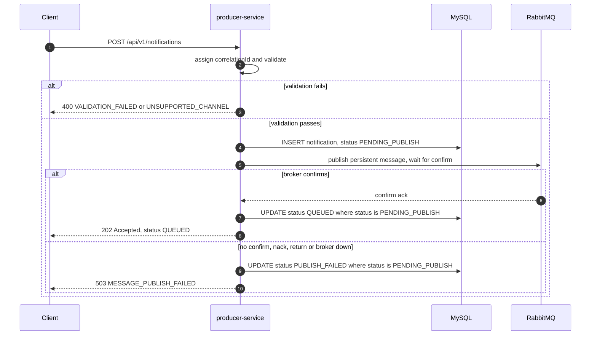

**Sequence:** assign the correlation ID → validate → store the record → publish and wait for the confirm → update status → respond.
**Success:** `202`, status `QUEUED`. The response says delivery has **not** been attempted.
**Failure:** invalid input → `400`, nothing stored or published. Publish failure → `503`, record `PUBLISH_FAILED`, `notificationId` included in the error.
**Final state:** success → row `QUEUED`, one message in the target queue. Validation failure → no state. Publish failure → row `PUBLISH_FAILED`.

---

## 2. Producer Publishing Flow

**Starting point:** the service has a stored `PENDING_PUBLISH` record and needs to publish.
**Participants:** `MessageFactory`, `RoutingKeySelector`, `NotificationPublisher`, RabbitMQ.

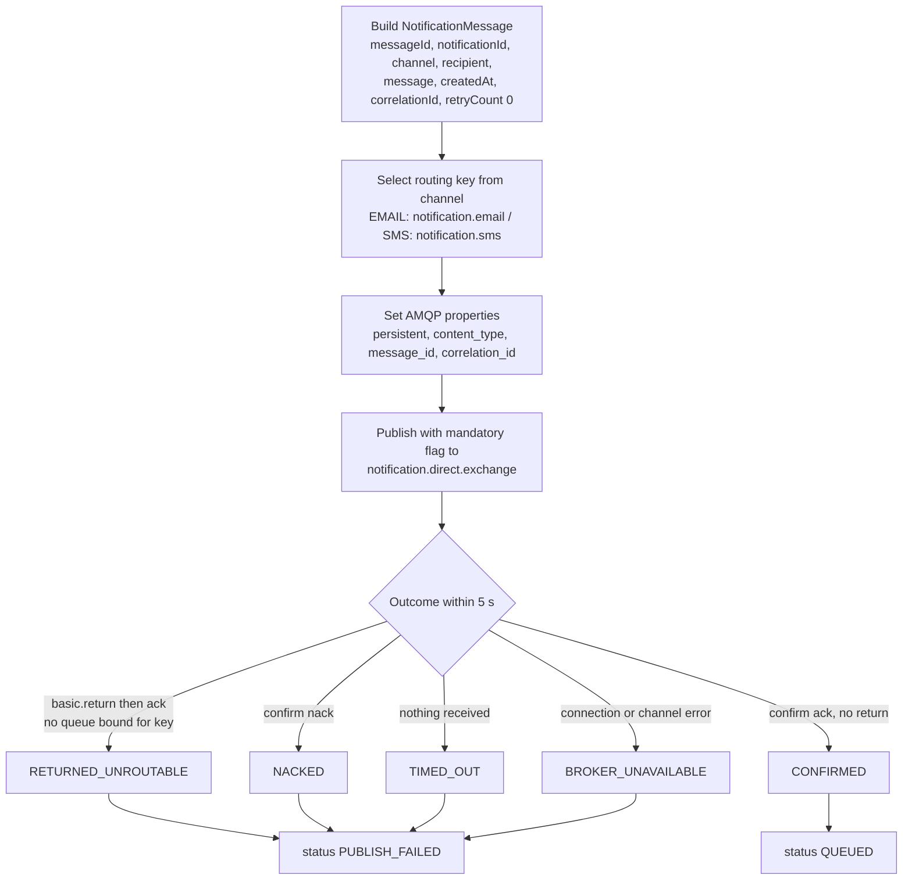

**Sequence:** build → pick key → set properties → publish → classify the outcome.
**Success:** `CONFIRMED` only when an ack arrives and no return was received.
**Failure:** four failure outcomes, all mapped to `PUBLISH_FAILED` / `503`. `TIMED_OUT` is ambiguous: the broker may have accepted the message.
**Final state:** `CONFIRMED` → message persisted in the bound queue. Others → the message may or may not exist in the broker (only for the timeout case); the record says `PUBLISH_FAILED`.

---

## 3. Direct Exchange Routing

**Starting point:** a message is published to `notification.direct.exchange`.
**Participants:** Producer, `notification.direct.exchange`, `email.queue`, `sms.queue`.

A direct exchange delivers a message to every queue whose **binding key exactly equals** the message's routing key.

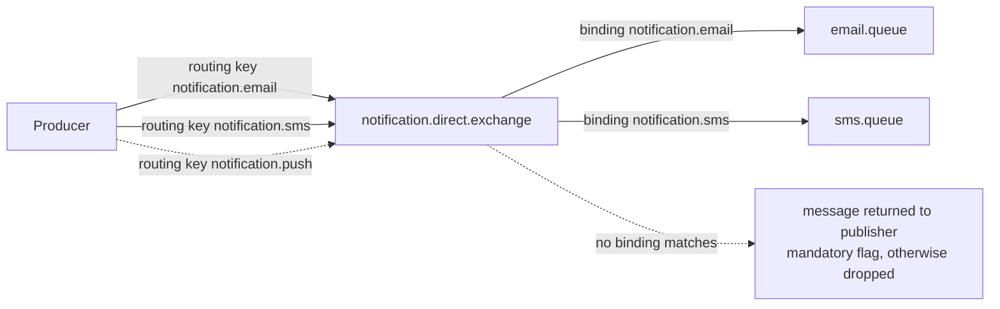

**Sequence:** exchange compares the routing key with its bindings → copies the message into each matching queue.
**Success:** `notification.email` → `email.queue` only; `notification.sms` → `sms.queue` only.
**Failure:** an unmatched key (`notification.push`, or a misspelling, or a missing binding) → **returned** to the Producer because `mandatory = true`. Without the flag the message would silently disappear. The API sees `RETURNED_UNROUTABLE` → `503`.
**Final state:** exactly one queue holds the message, or none and the publisher is told.

---

## 4. Topic Exchange Routing (lab scenario, `PD-07`)

**Starting point:** a lab publisher (Management UI, lab runner or test) publishes to `notification.topic.exchange`.
**Participants:** publisher, `notification.topic.exchange`, three lab queues.

A topic exchange matches routing keys made of dot-separated words against binding patterns. `*` matches exactly one word; `#` matches zero or more words.

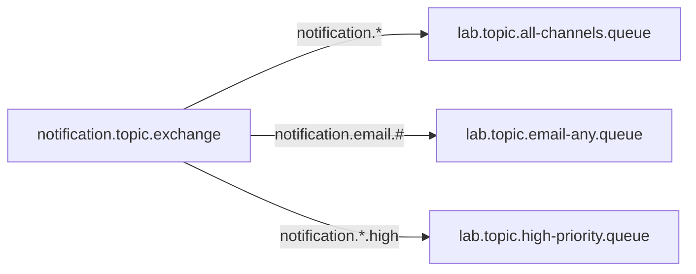

| Routing key published | all-channels `notification.*` | email-any `notification.email.#` | high-priority `notification.*.high` |
|---|---|---|---|
| `notification.email` | ✔ | ✔ | ✘ |
| `notification.sms` | ✔ | ✘ | ✘ |
| `notification.push` | ✔ | ✘ | ✘ |
| `notification.email.high` | ✘ (two words after `notification`) | ✔ | ✔ |
| `notification.sms.high` | ✘ | ✘ | ✔ |
| `order.created` | ✘ | ✘ | ✘ (unroutable) |

**Sequence:** match each binding pattern against the key → copy to every matching queue (a message can land in several queues).
**Success:** the table above is reproduced in the Management UI.
**Failure:** no pattern matches → unroutable (returned if mandatory; dropped otherwise).
**Final state:** each matching lab queue holds one copy. The main `email.queue` / `sms.queue` are unaffected because this exchange is separate.

---

## 5. Fanout Exchange Routing (lab scenario, `PD-07`)

**Starting point:** a lab publisher publishes to `notification.fanout.exchange`.
**Participants:** publisher, `notification.fanout.exchange`, `lab.fanout.audit.queue`, `lab.fanout.analytics.queue`.

A fanout exchange ignores the routing key and copies the message to **every** bound queue.

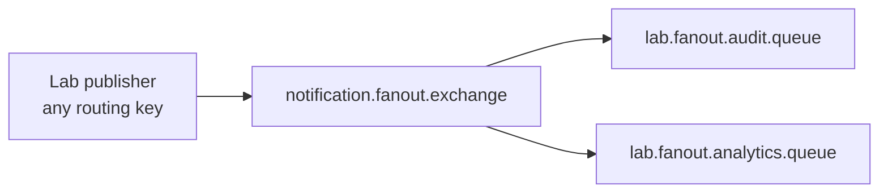

**Sequence:** publish → exchange copies to all bindings.
**Success:** one published message produces one copy in each of the two queues; publishing with any key, or an empty key, gives the same result.
**Failure:** with no queues bound the message is unroutable. If one queue is deleted, only the remaining queue receives copies.
**Final state:** each bound queue holds an independent copy (acknowledging one does not remove the other).

---

## 6. Email Consumer Processing Flow

**Starting point:** a message sits in `email.queue`.
**Participants:** `email.queue`, EmailNotificationListener, NotificationProcessingService, MySQL, EmailDeliverySimulator.

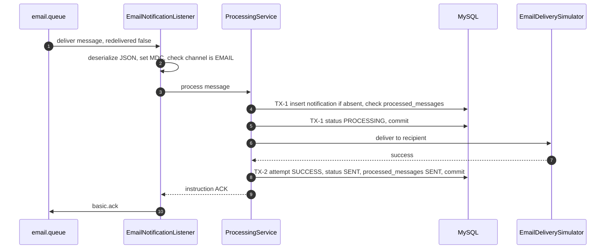

**Sequence:** receive → deserialize and sanity-check → TX-1 → simulate → TX-2 → ack.
**Success:** status `SENT`, one attempt row `SUCCESS`, one `processed_messages` row, message removed from the queue.
**Failure:** see flows 9–11 (temporary/permanent failure), 12 (duplicate), 13 (crash).
**Final state:** `SENT`, queue count reduced by one, unacked count back to its previous value.

---

## 7. SMS Consumer Processing Flow

**Starting point:** a message sits in `sms.queue`.
**Participants:** `sms.queue`, SmsNotificationListener, NotificationProcessingService, MySQL, SmsDeliverySimulator.

The SMS flow is structurally identical to the email flow. It is a separate listener container with its own concurrency and prefetch, so a backlog or failure in one channel does not block the other.

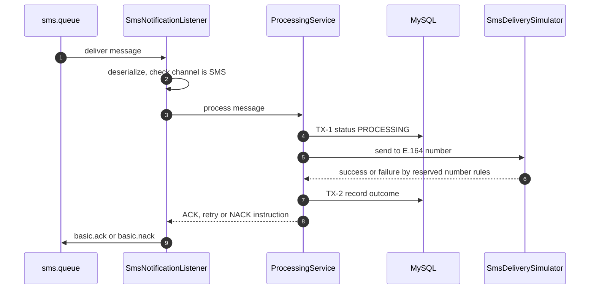

**Differences from the email flow:** queue `sms.queue`; consumer name `sms-consumer`; `SmsDeliverySimulator` with the SMS reserved numbers (`api.md` section 7); recipient is an E.164 number; independent tuning.
**Success / failure / final state:** same as flow 6.
**Independence demonstration:** stop the SMS listener (or fill `sms.queue` with `+15550100004` slow messages) while EMAIL notifications continue to be processed normally.

---

## 8. Successful Message Acknowledgement

**Starting point:** the simulator reports success.
**Participants:** listener, ProcessingService, MySQL, RabbitMQ.

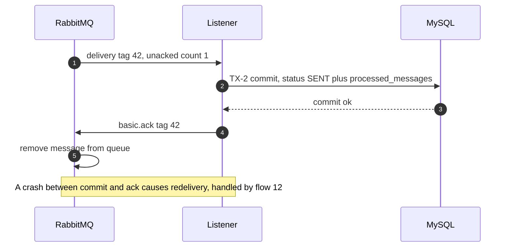

**Why the order matters:** the database commit comes **before** the ack. If the ack were first and the process then crashed, a successful outcome would never be recorded and the message would be gone. With commit-then-ack, the worst case is a redelivery, which is harmless because of idempotency.
**Success:** broker removes the message; unacked count drops.
**Failure:** connection lost before ack → broker requeues → flow 13 / flow 12.
**Final state:** message gone; DB shows `SENT`.

---

## 9. Failed Message Processing

**Starting point:** the simulator throws an exception, or an unexpected error occurs.
**Participants:** ProcessingService, FailureClassifier, MySQL, RabbitMQ.

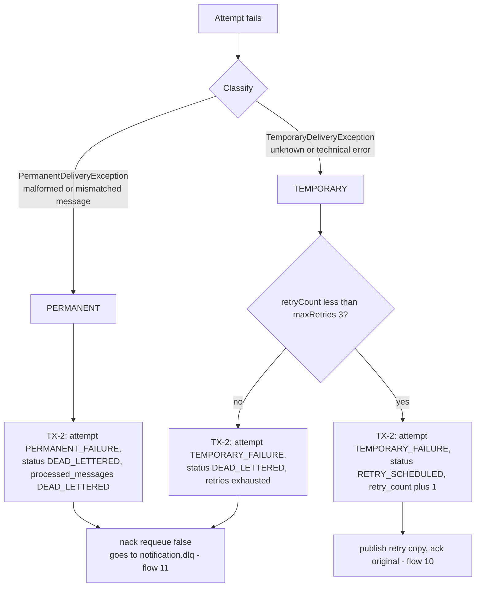

**Sequence:** classify → record outcome → choose retry or dead-letter.
**Success scenario:** a temporary failure that recovers on a later attempt (flow 10).
**Failure scenario:** permanent failure or exhausted retries (flow 11).
**Final state:** `RETRY_SCHEDULED` (message waiting in a retry queue) or `DEAD_LETTERED` (message in `notification.dlq`). A failed attempt never leaves the message unacknowledged.

---

## 10. Retry Flow

**Starting point:** a temporary failure with `retryCount < maxRetries`.
**Participants:** listener, ProcessingService, MySQL, `notification.retry.exchange`, `email.retry.queue`, `notification.direct.exchange`, `email.queue`.

Example: `flaky@example.com` (fails twice, then succeeds).

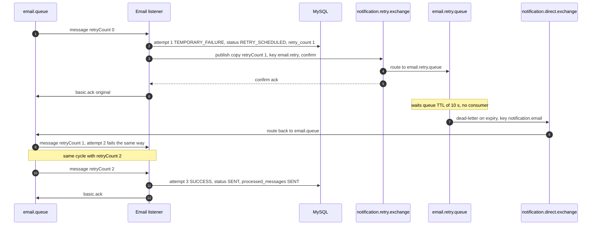

**Sequence:** record failure → publish copy to retry exchange (confirmed) → ack original → wait TTL → broker dead-letters back to the main queue → normal consumption.
**Success:** the third attempt succeeds; notification `SENT` with `retryCount = 2`, `attemptCount = 3`; about 20 s elapsed because of two 10 s waits.
**Failure:** (a) retry publish not confirmed → the original is `nack`ed with requeue after a short pause and handled again; (b) retries exhausted → flow 11; (c) crash after publishing the copy but before acking the original → two copies exist; the duplicate is absorbed by flow 12.
**Final state:** `email.retry.queue` empty again; message either consumed (`SENT`) or in the DLQ.

---

## 11. Dead Letter Queue Flow

**Starting point:** a permanent failure, exhausted retries, a malformed message, or a duplicate of an already dead-lettered message.
**Participants:** listener, MySQL, `email.queue` / `sms.queue`, `notification.dlx.exchange`, `notification.dlq`, operator.

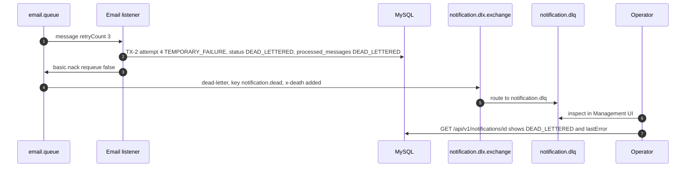

**Sequence:** record → `nack` without requeue → queue's dead-letter arguments forward the message to `notification.dlx.exchange` → `notification.dlq`.
**Success:** the message is parked safely instead of being lost or looping.
**Failure:** a malformed message has no DB row to update; only logs and the DLQ copy exist. If the process crashes between TX-2 commit and `nack`, the message is redelivered; the duplicate check sees `DEAD_LETTERED` and `nack`s again.
**Final state:** status `DEAD_LETTERED`; `notification.dlq` depth +1; no consumer reads the DLQ. Replay is manual and out of scope (`OQ-01`).

---

## 12. Duplicate Message Handling

**Starting point:** a message with an already-seen `messageId` is delivered.
**Participants:** listener, IdempotencyService, MySQL, RabbitMQ.

How duplicates arise: Producer resubmits after an ambiguous timeout; crash between TX-2 commit and `ack`; crash between retry publish and `ack`; manual re-publish in an experiment.

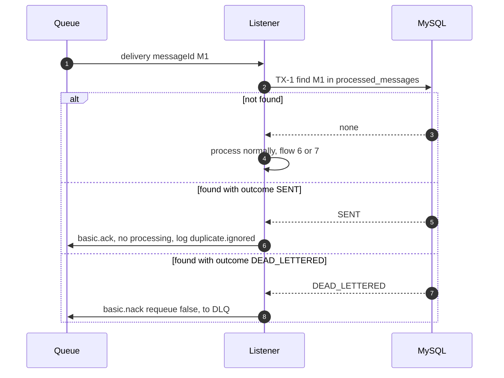

**Concurrent duplicates:** if two consumers handle the same `messageId` at the same time, both may pass the TX-1 check. The first to commit TX-2 wins; the second hits the primary-key conflict on `processed_messages`, rolls back, and is treated as a duplicate. The simulated delivery may have run twice (documented limitation `OQ-04`).
**Success:** one `SENT` outcome and one attempt row, however many deliveries arrive.
**Failure:** none expected; if the DB is down during the check, the message follows the technical-error path (flow 9).
**Final state:** unchanged from the first successful processing; the duplicate message is gone from the queue (acked) or in the DLQ (re-rejected).

---

## 13. Consumer Crash and Redelivery

**Starting point:** a consumer has received a message but terminates (process killed, network cut) before acknowledging.
**Participants:** RabbitMQ, crashed consumer, restarted or second consumer, MySQL.

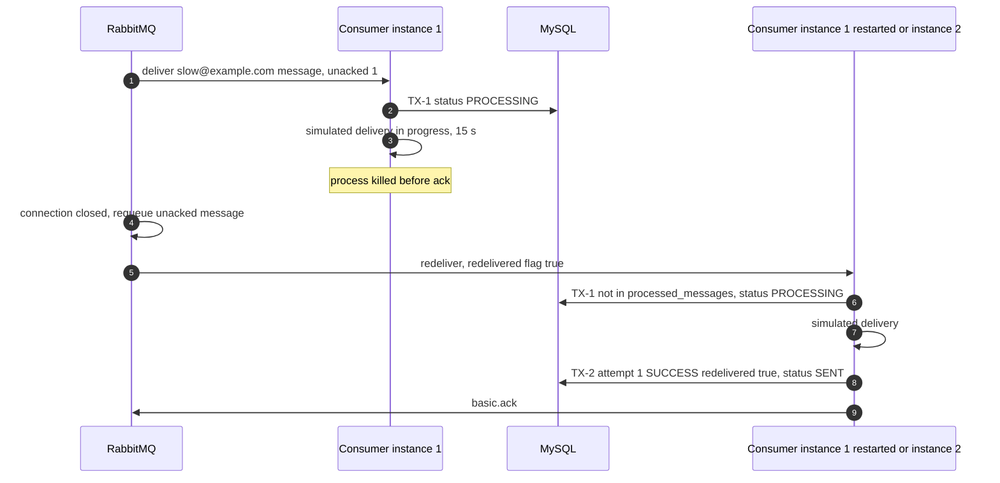

**Sequence:** broker detects the closed connection → returns unacked messages to the queue → redelivers with `redelivered = true`.
**Success:** the message is processed once; the attempt row has `redelivered = true`. No attempt row existed from the crashed run (rows are written at attempt end), so `attemptCount` is 1.
**Failure:** crash **after** TX-2 commit but before `ack` → the redelivery is a duplicate and is acked without processing (flow 12).
**Final state:** `SENT`. Messages are never lost, because the broker keeps the message until it is acknowledged. Between the crash and redelivery the status stays `PROCESSING`.

---

## 14. RabbitMQ Broker Restart Scenario

**Starting point:** the RabbitMQ container is restarted (`docker compose restart rabbitmq`).
**Participants:** producer-service, consumer-service, RabbitMQ (with persistent volume), MySQL.

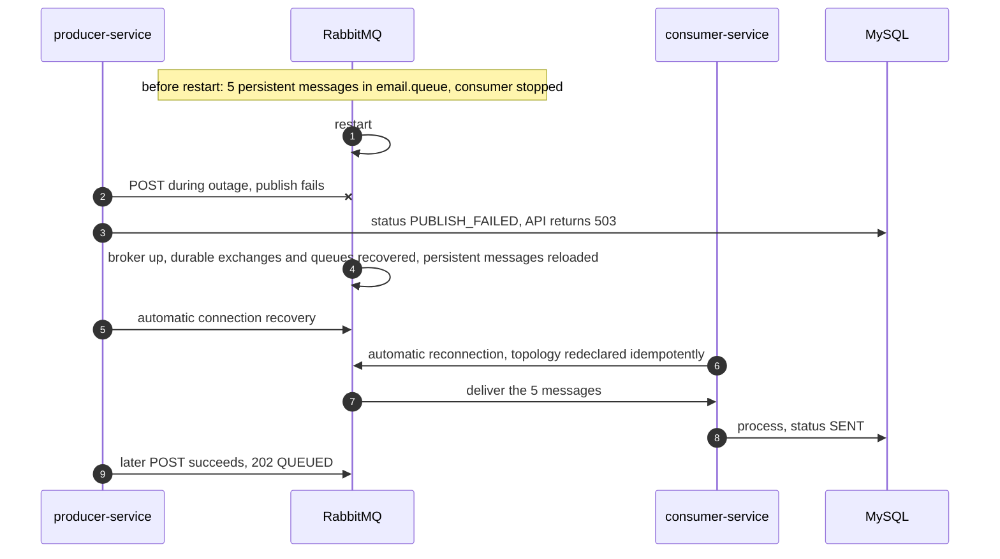

**Sequence:** broker stops → publishes during the outage fail → broker starts, recovers durable definitions and persistent messages from disk → applications reconnect → processing resumes.
**Success:** the 5 earlier messages are not lost; new submissions succeed again with no application restart.
**Failure:** (a) messages published as **non-persistent** or into **non-durable** queues are lost (Phase 4 experiment shows this deliberately); (b) a submission in flight during the restart gets `503`; (c) messages that had been delivered but not acked before the restart are redelivered (flow 13 logic).
**Final state:** queues and exchanges intact; counts match pre-restart values; statuses move forward normally. Queue arguments are unchanged, so no `PRECONDITION_FAILED`.

---

## 15. Notification Status Retrieval

**Starting point:** a client sends `GET /api/v1/notifications/{id}` (or the list endpoint).
**Participants:** Client, producer-service, MySQL. RabbitMQ is **not** involved.

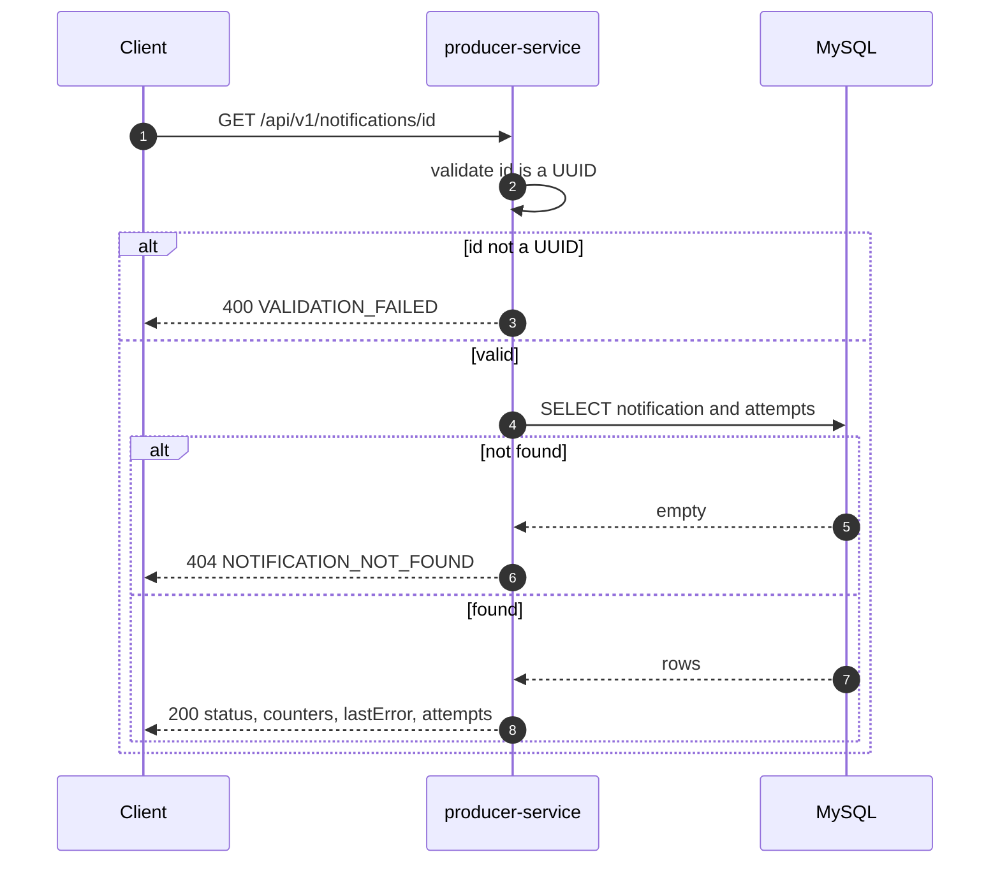

**List variant:** `GET /api/v1/notifications?status=...&channel=...&page=0&size=20` → validate filters and paging (`400 INVALID_FILTER` / `INVALID_PAGINATION`) → paged query using the `(status, created_at)` or `(channel, created_at)` indexes → `200` with the page envelope.
**Success:** current committed state returned; a freshly submitted notification shows `QUEUED` even when no consumer is running.
**Failure:** DB error → `500 INTERNAL_ERROR`.
**Final state:** read-only; no change. Because processing is asynchronous, two reads may return different statuses.

---

## 16. Status Transition Diagram (reference)

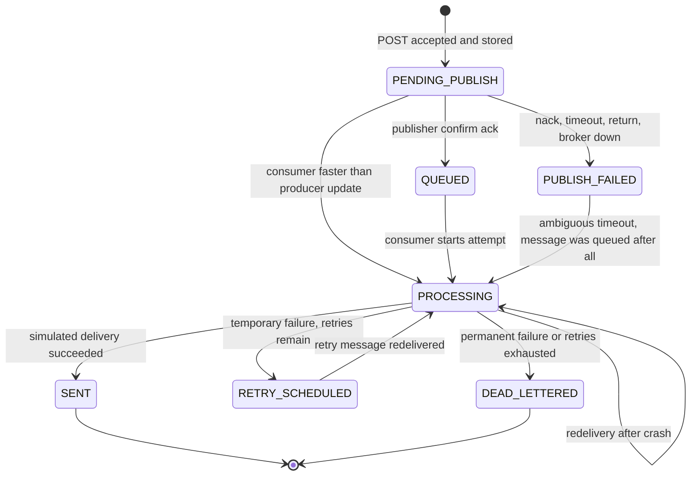

`PUBLISH_FAILED` is a final status from the Producer's point of view, but a consumer may still move it forward in the rare ambiguous-timeout case. `SENT` and `DEAD_LETTERED` never change.

## 17. Consistency Check Against the Architecture

| Item | Where defined | Used in flows |
|---|---|---|
| Exchanges and queues | `project.md` 8.1–8.2, `implementation.md` 5 | 2, 3, 4, 5, 10, 11 |
| Message fields | `project.md` 8.3 | 1, 2, 10 |
| Statuses | `project.md` 9.1 | 1, 6–16 |
| Transactions TX-1 / TX-2 / PTX | `implementation.md` 9 | 1, 6, 8, 10, 11, 12 |
| Retry settings (3 retries, 10 s) | `implementation.md` 5.4, 17 | 9, 10 |
| Simulation rules | `api.md` 7, `implementation.md` 10 | 6, 7, 10, 13 |
