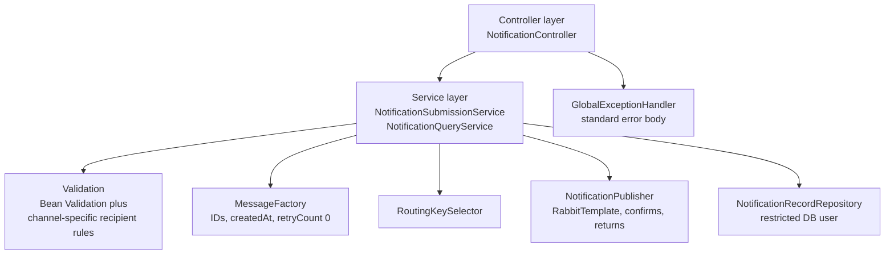
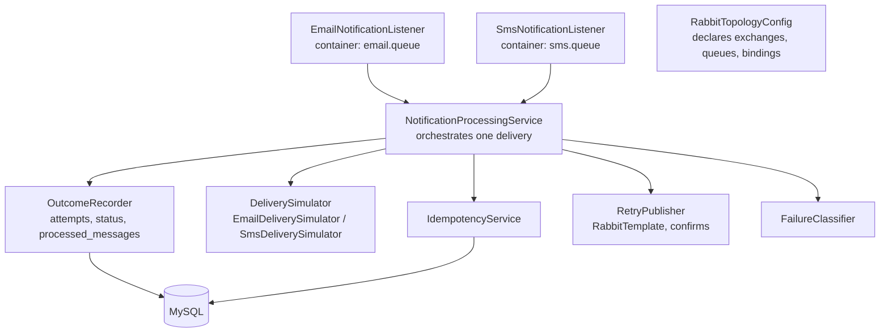
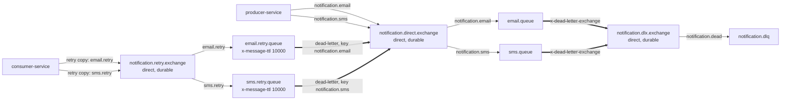

# RabbitMQ Engineering Lab — Implementation Strategy

> **Related:** `project.md` (requirements and decision register), `api.md` (contract), `flow.md` (diagrams), `roadmap.md` (task order)
> This document explains **how** the system will be built and **why** each decision was made. It contains no Java source code. Names of classes appear only to describe responsibilities. Decision IDs (`PD-xx`, `OQ-xx`) refer to the register in `project.md` section 15.

---

## 1. Technology Choices and Reasons

| Technology | Why we use it here | Notes |
|---|---|---|
| Java 21 | Current long-term-support release; records suit immutable message DTOs. | Virtual threads are *not* used for listeners; we want to study platform-thread concurrency and prefetch explicitly. |
| Spring Boot 3 | Auto-configuration for web, JPA, AMQP, Actuator. | Requires Java 17+. |
| Spring AMQP | Declarative topology (`Declarable` beans), listener containers, `RabbitTemplate` with confirms. | Gives us access to channel-level calls for manual ack. |
| RabbitMQ 4 (`rabbitmq:4-management`) | The subject of the lab. The management image includes the UI. | Mirrored classic queues no longer exist in 4.x; quorum queues are the replicated type (`PD-05`). |
| MySQL 8 | Durable store for notification state. | `CHECK` constraints are enforced from 8.0.16. |
| Spring Data JPA / Hibernate | Fast repository development; optimistic locking via a version column. | Producer uses `ddl-auto=validate`; schema changes only through migrations. |
| Flyway (`PD-11`) | Versioned, repeatable schema creation shared by dev and Testcontainers. | Lives in `consumer-service` (schema owner). |
| Maven | Multi-module builds and dependency management. | A parent POM manages versions via the Spring Boot BOM. |
| Docker Compose | One command for RabbitMQ and MySQL. | Applications run on the host (`PD-15`). |
| JUnit 5 + Mockito + AssertJ + Awaitility | Unit and asynchronous assertions. | All come with the Spring Boot test starter. |
| Testcontainers | Real RabbitMQ and MySQL in tests. | Mocks cannot show redelivery or dead-lettering behaviour. |
| springdoc-openapi | Generates OpenAPI and Swagger UI from the controllers. | `api.md` remains the authoritative contract; the generated document must match it. |

## 2. Maven Multi-Module Architecture

```text
rabbitmq-engineering-lab/
├── pom.xml                   (parent: dependency management, Java 21, plugins)
├── docker/
│   ├── docker-compose.yml
│   └── mysql-init/           (creates schema and DB users)
├── documentation/            (the five Markdown files)
├── shared-contracts/
├── producer-service/
└── consumer-service/
```

### 2.1 Module Responsibilities and Dependencies

| Module | Contains | Must **not** contain | Depends on |
|---|---|---|---|
| `shared-contracts` | `NotificationMessage` DTO; `NotificationChannel` enum; constants for exchange, queue and routing-key names; JSON field names. Pure Java plus Jackson annotations. | Spring beans, RabbitMQ configuration, JPA, business logic. | Jackson annotations only. |
| `producer-service` | REST controllers, validation, orchestration, publisher, producer-side persistence access, exception mapping. | Delivery simulation, retry logic, listener code. | `shared-contracts` |
| `consumer-service` | Listeners, processing orchestration, delivery simulators, retry publisher, topology declaration, JPA entities, Flyway migrations. | REST business endpoints. | `shared-contracts` |

**Rule:** `producer-service` and `consumer-service` must never depend on each other. All shared knowledge goes through `shared-contracts`.

**Contract evolution (Proposed).** Adding an optional field is backward compatible because DTOs ignore unknown properties on read. Renaming or removing a field is a breaking change and requires a new contract version (e.g. a `schemaVersion` field or a new routing key); this is not needed initially.

## 3. Producer Architecture

### 3.1 Layers



| Component | Responsibility |
|---|---|
| `NotificationController` | HTTP mapping only. No business logic. Sets `X-Correlation-Id` handling through a servlet filter. |
| `NotificationSubmissionService` | Orchestrates: validate → create record → build message → publish and await confirm → update status → return result. |
| `NotificationQueryService` | Implements `GET` by ID and list with filters; maps entities to response DTOs. |
| `RoutingKeySelector` | Maps `EMAIL` → `notification.email`, `SMS` → `notification.sms`. Pure function; trivial to unit test. |
| `MessageFactory` | Generates `messageId`, `notificationId`; stamps `createdAt` (UTC) and `retryCount = 0`. |
| `NotificationPublisher` | The only class that talks to `RabbitTemplate`. Returns a typed result: `CONFIRMED`, `NACKED`, `TIMED_OUT`, `RETURNED_UNROUTABLE`, `BROKER_UNAVAILABLE`. |
| `NotificationRecordRepository` | Producer's limited view of `notifications`. |
| `CorrelationIdFilter` | Reads or generates `X-Correlation-Id`, puts it in the logging context (MDC), echoes it in the response. |

### 3.2 Submission Algorithm (design level)

1. Filter assigns the correlation ID.
2. Controller binds and validates the body (`api.md` section 3.2).
3. Service generates `notificationId` and `messageId` (random UUIDs) and builds the message.
4. Service inserts the `notifications` row with status `PENDING_PUBLISH` (short transaction, committed before publishing).
5. Publisher sends the message and waits for the confirm result (`PD-08`).
6. On `CONFIRMED`: conditional update `PENDING_PUBLISH → QUEUED` (the `WHERE status = 'PENDING_PUBLISH'` guard means a faster Consumer is never overwritten). Return `202`.
7. On any other result: conditional update `PENDING_PUBLISH → PUBLISH_FAILED`, return `503`.

**Why commit the row before publishing?** If the row were inserted *after* publishing, a fast Consumer could process the message before the Producer's row exists, and the Producer would then insert a conflicting row. Inserting first means the Consumer always finds a row (and still handles the "no row" case defensively by creating one).

**Known gap (`OQ-02`).** Steps 4 and 5 are two separate resources (MySQL and RabbitMQ); no transaction spans both. If the Producer crashes between them, a row stays `PENDING_PUBLISH` forever. We accept this, detect it with a query (roadmap T-9.6), and note a transactional outbox as a future fix.

## 4. Consumer Architecture



| Component | Responsibility |
|---|---|
| Listeners (two) | Receive the delivery and its channel/tag, deserialize, call the processing service, perform the final `ack` or `nack`. Only listeners touch the AMQP channel. |
| `NotificationProcessingService` | Contains the processing algorithm (section 11.1) independent of AMQP types, so it can be unit-tested. Returns an *instruction* (`ACK`, `NACK_NO_REQUEUE`, `NACK_REQUEUE`) to the listener. |
| `IdempotencyService` | Looks up and writes `processed_messages`. |
| `DeliverySimulator` (per channel) | Returns success or throws `TemporaryDeliveryException` / `PermanentDeliveryException` according to the rules in section 10. |
| `FailureClassifier` | Maps exceptions to `TEMPORARY` or `PERMANENT`. Unknown exceptions are `TEMPORARY`. |
| `OutcomeRecorder` | Runs the DB transactions of section 9. |
| `RetryPublisher` | Publishes the retry copy with confirm. |
| `RabbitTopologyConfig` | Declares everything in section 5 (`PD-06`). |

Each channel has its **own listener container factory** so concurrency and prefetch can differ (FR-C-01, FR-C-02, FR-C-11).

### 4.1 Package Layout (proposed)

`com.example.notificationlab.contracts` · `com.example.notificationlab.producer.{api, service, messaging, persistence, config, error}` · `com.example.notificationlab.consumer.{listener, service, simulation, messaging, persistence, config, error}`.

## 5. RabbitMQ Topology Configuration

### 5.1 Approach

- Topology is declared **in code** using Spring AMQP so we can learn the declaration model (`PD-06`).
- `consumer-service` declares all exchanges, queues and bindings (queues belong to consumers). `producer-service` declares only `notification.direct.exchange`; declaring an identical exchange twice is harmless.
- All names come from `shared-contracts` constants. No string literals for names elsewhere.
- Queue and exchange **arguments are immutable** in RabbitMQ. Changing a TTL or a dead-letter argument on an existing queue causes a `PRECONDITION_FAILED` channel error at startup. The fix in the lab is to delete the queue in the Management UI (or reset the Docker volume). This is itself a learning point and is called out in the roadmap.
- Unroutable messages: if the Producer starts before the Consumer has ever declared the queues, the broker has no binding for the key and returns the message (mandatory flag) → `503`. Start order for the first run: infrastructure → consumer → producer.

### 5.2 Main Topology



### 5.3 Exchange Definitions

| Exchange | Type | Durable | Auto-delete | Declared by |
|---|---|---|---|---|
| `notification.direct.exchange` | direct | yes | no | producer and consumer |
| `notification.retry.exchange` | direct | yes | no | consumer |
| `notification.dlx.exchange` | direct | yes | no | consumer |
| `notification.topic.exchange` | topic | yes | no | consumer, **only** with profile `lab-exchanges` |
| `notification.fanout.exchange` | fanout | yes | no | consumer, **only** with profile `lab-exchanges` |

### 5.4 Queue Definitions

| Queue | Durable | Arguments | Bindings | Consumers |
|---|---|---|---|---|
| `email.queue` | yes | `x-dead-letter-exchange = notification.dlx.exchange`, `x-dead-letter-routing-key = notification.dead` | `notification.direct.exchange` / `notification.email` | email listener (concurrency 2–4, prefetch 10 — `PD-10`) |
| `sms.queue` | yes | same dead-letter arguments | `notification.direct.exchange` / `notification.sms` | SMS listener |
| `email.retry.queue` | yes | `x-message-ttl = 10000` (from property), `x-dead-letter-exchange = notification.direct.exchange`, `x-dead-letter-routing-key = notification.email` | `notification.retry.exchange` / `email.retry` | none |
| `sms.retry.queue` | yes | same TTL; dead-letter key `notification.sms` | `notification.retry.exchange` / `sms.retry` | none |
| `notification.dlq` | yes | none | `notification.dlx.exchange` / `notification.dead` | none (manual inspection) |

Why **queue-level fixed TTL** and not per-message TTL: RabbitMQ delivers and expires messages from the head of the queue. With per-message TTLs, a message with a 60 s TTL at the head blocks a message with a 5 s TTL behind it. A fixed TTL for every message in the queue means the head always expires first, so ordering and timing are predictable.

Why **one DLQ** (`PD-04`): messages carry their `channel`, so operators can distinguish them; one place to monitor. The trade-off is that a flood of one channel's failures is mixed with the other's. Per-channel DLQs would be a simple later change.

Why **classic durable queues** first (`PD-05`): behaviour is the easiest to observe. In RabbitMQ 4, quorum queues are recommended when replication and strong data safety matter and have built-in delivery-limit poison-message protection. An optional Phase 10 experiment migrates the main queues to quorum queues and compares behaviour.

### 5.5 Lab Exchanges (`PD-07`)

Active only with Spring profile `lab-exchanges`. Lab queues are consumed by a logging-only listener. Publishing is done by a lab runner in `producer-service` (profile `lab`, no REST endpoint), by the Management UI "Publish message" form, and by integration tests.

| Scenario | Exchange | Lab queue | Binding key | Matches these routing keys |
|---|---|---|---|---|
| Topic | `notification.topic.exchange` | `lab.topic.all-channels.queue` | `notification.*` | `notification.email`, `notification.sms`, `notification.push` (exactly one word after the dot) |
| Topic | same | `lab.topic.email-any.queue` | `notification.email.#` | `notification.email`, `notification.email.high` (`#` = zero or more words) |
| Topic | same | `lab.topic.high-priority.queue` | `notification.*.high` | `notification.email.high`, `notification.sms.high` |
| Fanout | `notification.fanout.exchange` | `lab.fanout.audit.queue` | (none; key ignored) | every message |
| Fanout | same | `lab.fanout.analytics.queue` | (none; key ignored) | every message |

The main notification path never uses these exchanges.

## 6. Message Serialization

| Topic | Decision |
|---|---|
| Format | JSON, UTF-8, via Spring AMQP's Jackson message converter on both sides. |
| Properties set on every message | `content_type = application/json`, `delivery_mode = 2` (persistent), `message_id = messageId`, `correlation_id = correlationId`, `timestamp = createdAt`. |
| Body vs properties | The **body is authoritative**. AMQP properties duplicate IDs only so that broker tools (Management UI, tracing) can display them. |
| Type information | The Consumer must **not** rely on the Java type header written by the Producer's converter, because the two services do not share class packages beyond `shared-contracts`. Each listener declares the expected type explicitly. |
| Time | `createdAt` is ISO-8601 UTC string (not a numeric epoch). |
| Unknown fields | Ignored on read (forward compatibility). |
| Missing required fields / invalid JSON | Treated as a *malformed message* (section 13). |
| Validation on the Consumer | Light structural checks (required fields non-null, channel matches the queue). A mismatch is a permanent failure. |

## 7. Publisher Confirms and Reliable Publishing

**What it is.** A *publisher confirm* is the broker's asynchronous acknowledgement to the publisher that it has taken responsibility for a message (for a persistent message on a durable queue: written to disk, per the broker's rules). Without confirms, `publish` returning only means "the bytes were handed to the network".

| Aspect | Decision |
|---|---|
| Mode | Correlated confirms enabled; each publish carries a correlation object that completes when the broker acks or nacks. |
| Mandatory flag | `true` for all publishes. If no queue is bound for the routing key, the broker **returns** the message before confirming. |
| Returns | Publisher returns callback enabled; a returned message marks the publish `RETURNED_UNROUTABLE` (→ `503`). |
| Waiting | The submission thread waits for the confirm, default timeout 5 s (`PD-08`). Synchronous waiting keeps the API contract simple: `202` means the broker confirmed. Cost: request latency includes the broker round trip. |
| Ack | Confirm ack → status `QUEUED`. |
| Nack | Broker could not take the message (internal error) → `PUBLISH_FAILED`. |
| Timeout | Ambiguous (the broker may have accepted it). Status `PUBLISH_FAILED`, error `503`; documented caveat in `api.md`. |
| Broker unavailable | Connection errors surface as `BROKER_UNAVAILABLE` → `503`. Spring AMQP recovers the connection automatically once the broker is back. |
| No local buffering | The Producer does not store-and-forward. Failed submissions are reported, not queued locally. A transactional outbox would be the future solution (`OQ-02`). |
| What a confirm does **not** mean | It does not mean a consumer received, processed or delivered anything. |

The Consumer's `RetryPublisher` uses the same confirm mechanics.

## 8. Database Integration

### 8.1 Schema Ownership and Access (`PD-01`)

- Schema `notification_lab`, MySQL 8, InnoDB, `utf8mb4`.
- Flyway migrations live in `consumer-service`.
- Two database users:

| User | Privileges | Used by |
|---|---|---|
| `lab_consumer` | Full DML on the schema (and DDL for Flyway in the lab). | `consumer-service` |
| `lab_producer` | `SELECT` on all three tables; `INSERT` on `notifications`; `UPDATE` only on the columns `status`, `queued_at`, `updated_at`, `completed_at`, `last_error`, `version` of `notifications`. | `producer-service` |

- Column ownership: the Producer sets `PENDING_PUBLISH`, `QUEUED` and `PUBLISH_FAILED`. The Consumer sets all later statuses. Both use **conditional updates** (`WHERE status IN (...)`) so neither overwrites a state it must not.
- The Producer's JPA mapping is a minimal entity for the same table with `ddl-auto = validate`. How its tests get the schema is `OQ-03`.

### 8.2 Table: `notifications`

| Column | Type | Null | Notes |
|---|---|---|---|
| `id` | `CHAR(36)` | no | **PK**. The `notificationId` (`OQ-07`). |
| `message_id` | `CHAR(36)` | no | **Unique**. |
| `channel` | `VARCHAR(10)` | no | `EMAIL` or `SMS`; `CHECK` constraint. |
| `recipient` | `VARCHAR(254)` | no | |
| `message` | `VARCHAR(1000)` | no | |
| `status` | `VARCHAR(20)` | no | Values in `project.md` 9.1; `CHECK` constraint. |
| `correlation_id` | `VARCHAR(64)` | no | |
| `retry_count` | `INT` | no | Default 0. Retries scheduled so far. |
| `attempt_count` | `INT` | no | Default 0. Finished attempts. |
| `last_error` | `VARCHAR(500)` | yes | |
| `created_at` | `DATETIME(3)` | no | Message creation time (UTC). |
| `queued_at` | `DATETIME(3)` | yes | Confirm time. |
| `completed_at` | `DATETIME(3)` | yes | Set on `SENT`, `DEAD_LETTERED`, `PUBLISH_FAILED`. |
| `updated_at` | `DATETIME(3)` | no | |
| `version` | `BIGINT` | no | Optimistic-locking counter. |

**Indexes (recommended):** PK on `id`; unique on `message_id`; `(status, created_at)` for filtered lists and stuck-record queries; `(channel, created_at)`; `(created_at)` for default sort and date filters. Add further indexes only after measuring.

### 8.3 Table: `notification_attempts`

| Column | Type | Null | Notes |
|---|---|---|---|
| `id` | `BIGINT AUTO_INCREMENT` | no | **PK**. |
| `notification_id` | `CHAR(36)` | no | **FK** → `notifications.id`, `ON DELETE RESTRICT`. |
| `message_id` | `CHAR(36)` | no | |
| `attempt_number` | `INT` | no | 1-based. |
| `consumer_name` | `VARCHAR(30)` | no | `email-consumer` or `sms-consumer`. |
| `outcome` | `VARCHAR(25)` | no | `SUCCESS`, `TEMPORARY_FAILURE`, `PERMANENT_FAILURE`. |
| `error_code` | `VARCHAR(50)` | yes | |
| `error_message` | `VARCHAR(500)` | yes | |
| `redelivered` | `BOOLEAN` | no | AMQP redelivered flag of the delivery. |
| `started_at`, `finished_at` | `DATETIME(3)` | no | |

**Constraints:** unique `(notification_id, attempt_number)` — guards against two concurrent writers recording the same attempt. **Index:** that unique index also serves lookups by `notification_id`.

Attempts are written **when an attempt finishes**, not when it starts. A consumer that crashes mid-attempt leaves no row; the redelivery produces the row. This keeps the table free of "dangling started" rows.

### 8.4 Table: `processed_messages`

| Column | Type | Null | Notes |
|---|---|---|---|
| `message_id` | `CHAR(36)` | no | **PK** — this *is* the idempotency key. |
| `notification_id` | `CHAR(36)` | no | **FK** → `notifications.id`. |
| `consumer_name` | `VARCHAR(30)` | no | |
| `outcome` | `VARCHAR(20)` | no | `SENT` or `DEAD_LETTERED`. |
| `processed_at` | `DATETIME(3)` | no | |

**Indexes:** PK; `(notification_id)`; `(processed_at)` to support a future retention job (`OQ-06`).

### 8.5 Relationships

`notifications` 1 — 0..N `notification_attempts`; `notifications` 1 — 0..N `processed_messages` (exactly 0 or 1 today). There are no cascades; nothing is deleted in this project.

## 9. Transaction Boundaries and Status Transitions

### 9.1 Principles

1. **Never hold a DB transaction open while calling the simulated provider or RabbitMQ.** External calls can be slow; long transactions waste connections and lock rows.
2. **Record the outcome durably *before* acknowledging the message.** The ack is the last step. A crash before the ack causes redelivery (safe thanks to idempotency); an ack before the record would risk losing work.
3. Broker and database cannot be in one atomic transaction. We design for the gap instead of pretending it does not exist.

### 9.2 Consumer Transactions

| Transaction | Contents | Commit point |
|---|---|---|
| **TX-1 "start attempt"** (short) | Insert the `notifications` row if absent; check `processed_messages` for `messageId`; if not final, conditionally set status `PROCESSING`. | Before the simulated delivery. |
| *(no transaction)* | Call the delivery simulator. | |
| **TX-2 "record outcome"** (short) | Insert the `notification_attempts` row; update `notifications` (status, `attempt_count`, `retry_count`, `last_error`, `completed_at`); on a final outcome insert `processed_messages`. All together. | Before ack/nack or before publishing the retry copy. |

If TX-2's insert into `processed_messages` fails with a duplicate key, the whole TX-2 rolls back and the message is treated as a duplicate (section 11.4).

### 9.3 Producer Transactions

| Transaction | Contents |
|---|---|
| **PTX-1** | Insert `notifications` row with `PENDING_PUBLISH`. Committed before publishing. |
| **PTX-2** | Conditional update to `QUEUED` or `PUBLISH_FAILED` after the publish outcome. |

### 9.4 Allowed Status Transitions

| From | To | By | Condition |
|---|---|---|---|
| (none) | `PENDING_PUBLISH` | Producer | New request. |
| `PENDING_PUBLISH` | `QUEUED` | Producer | Confirm ack. |
| `PENDING_PUBLISH` | `PUBLISH_FAILED` | Producer | Nack, timeout, return, broker unavailable. |
| `PENDING_PUBLISH`, `QUEUED`, `PUBLISH_FAILED`, `RETRY_SCHEDULED`, `PROCESSING` | `PROCESSING` | Consumer | Start of an attempt. (`PENDING_PUBLISH` happens when the Consumer is faster than the Producer's update; `PUBLISH_FAILED` happens when a confirm timeout was ambiguous; `PROCESSING` happens on redelivery after a crash.) |
| `PROCESSING` | `SENT` | Consumer | Success. |
| `PROCESSING` | `RETRY_SCHEDULED` | Consumer | Temporary failure, retries remain. |
| `PROCESSING` | `DEAD_LETTERED` | Consumer | Permanent failure or retries exhausted. |

`SENT` and `DEAD_LETTERED` are final. The diagram is in `flow.md` section 16.

## 10. Delivery Simulation (`PD-12`)

Real providers are out of scope. Each channel has a simulator whose behaviour is chosen **deterministically from the recipient**, so tests and experiments are reproducible.

| Rule | EMAIL recipient | SMS recipient | Behaviour |
|---|---|---|---|
| Normal | any other value | any other value | Wait 100–500 ms (configurable), succeed. |
| Always temporary failure | `temp-fail@example.com` | `+15550100001` | Throw `TemporaryDeliveryException` ("Simulated provider timeout") on every attempt. |
| Flaky | `flaky@example.com` | `+15550100002` | Temporary failure while `retryCount < 2`; success afterwards. |
| Permanent failure | `perm-fail@example.com` | `+15550100003` | Throw `PermanentDeliveryException` ("recipient rejected by provider (simulated)"). |
| Slow | `slow@example.com` | `+15550100004` | Wait about 15 s, then succeed. Used to kill a consumer mid-processing and to observe prefetch. |

The simulator is selectable and can be disabled by configuration so a real provider adapter could replace it later (**Future**). `retryCount` is read from the message, so "flaky" is deterministic across consumers.

## 11. Acknowledgement, Retry and DLQ Strategy

### 11.1 Processing Algorithm (per delivery)

1. The listener receives the delivery (container acknowledge mode **manual**).
2. Deserialize. On failure → *malformed* path (section 13): `nack` without requeue.
3. Put `correlationId`, `notificationId`, `messageId` into the logging context.
4. **TX-1.** If `processed_messages` contains `messageId` → *duplicate path* (11.4) and stop. Otherwise status becomes `PROCESSING`.
5. Call the simulator (outside any transaction).
6. Handle the outcome:

| Outcome | TX-2 effect | Broker action |
|---|---|---|
| Success | attempt `SUCCESS`; status `SENT`; `processed_messages(SENT)` | `ack` |
| Permanent failure | attempt `PERMANENT_FAILURE`; status `DEAD_LETTERED`; `processed_messages(DEAD_LETTERED)` | `nack`, requeue = false → dead-letters to `notification.dlq` |
| Temporary failure, `retryCount < maxRetries` | attempt `TEMPORARY_FAILURE`; status `RETRY_SCHEDULED`; `retry_count` = `retryCount + 1` | Publish retry copy (11.2), await confirm; on confirm `ack` the original |
| Temporary failure, `retryCount >= maxRetries` | attempt `TEMPORARY_FAILURE`; `last_error` = "retries exhausted after N attempts"; status `DEAD_LETTERED`; `processed_messages(DEAD_LETTERED)` | `nack`, requeue = false |
| Unexpected technical error (e.g. DB unavailable) | none (DB unavailable) | Treat as temporary: if `retryCount < maxRetries` publish retry copy and `ack`; else `nack` requeue = false (message lands in the DLQ; the DB row is reconciled by hand) |

7. Clear the logging context.

### 11.2 Retry Mechanism

1. The Consumer publishes a **new message** to `notification.retry.exchange` with key `email.retry` or `sms.retry`. The copy has the **same** `messageId`, `notificationId`, `correlationId`, `createdAt`, and `retryCount + 1` (`PD-03`). It is persistent, mandatory and confirmed.
2. The message waits in `email.retry.queue` or `sms.retry.queue` for the fixed TTL (default 10 s).
3. On TTL expiry the broker dead-letters it to `notification.direct.exchange` with the queue's configured key (`notification.email` or `notification.sms`), which routes it back to the main queue.
4. A consumer takes it again; the cycle repeats until success or until `retryCount` reaches `maxRetries`.

**Why the Consumer republishes (`PD-03`) instead of simply rejecting into a DLX → retry queue:** a rejected message keeps its original body, so `retryCount` could not be incremented in the JSON contract; counting would depend on RabbitMQ's `x-death` header. Republishing keeps the contract field meaningful and testable. The trade-off is a window where the original and the copy both exist (crash after publishing the copy but before acking the original). The idempotent consumer absorbs this (flow 12).

**Why not retry inside the consumer (sleep and loop):** it ties up a thread and a prefetch slot, loses state on crash and hides the retry from RabbitMQ.

**If the retry publish is not confirmed** (broker problem): `nack` with requeue = true after a short pause (about 1 s) so the message returns to the main queue. This is bounded in practice because the broker itself is failing; the possible hot loop with a permanently misconfigured retry exchange is demonstrated and discussed in the roadmap (Phase 4 and Phase 5 experiments).

### 11.3 Dead-Letter Handling

- A message reaches `notification.dlq` only when the Consumer calls `nack` with requeue = false (permanent failure, exhausted retries, malformed, DLQ-state duplicate).
- RabbitMQ adds an `x-death` header recording queue, reason (`rejected`) and count, visible in the Management UI.
- The business reason is in `notifications.last_error` and `notification_attempts`.
- Operators inspect the DLQ in the Management UI. Replay is manual and out of scope (`OQ-01`).
- There is no consumer on `notification.dlq`; its depth is a monitored metric.

### 11.4 Idempotency Strategy

**Idempotency key:** `messageId`. It is generated once by the Producer and kept across redelivery and retries.

| Layer | Mechanism |
|---|---|
| Fast check | TX-1 looks up `messageId` in `processed_messages`. |
| Hard guarantee | Primary key on `processed_messages.message_id`, inserted in the same transaction as the final outcome. A concurrent duplicate that finishes second gets a duplicate-key error, rolls back and is treated as a duplicate. |
| Attempt integrity | Unique `(notification_id, attempt_number)`. |

**Duplicate handling:** if the recorded outcome is `SENT` → `ack` the duplicate. If `DEAD_LETTERED` → `nack` with requeue = false so the duplicate also ends in the DLQ and is not lost.

**Retries are not duplicates:** `processed_messages` is written only for **final** outcomes, so a retry copy (same `messageId`) is processed normally.

**What it prevents and what it does not (`PD-13`, `OQ-04`):** it prevents a second *recorded* outcome and any processing after a final outcome exists. It cannot stop two in-flight attempts of the same message (e.g. original redelivered while a retry copy exists) from both calling an external provider *before* either records a final outcome. With a simulated provider this only produces a duplicated log line; with a real provider you would also need a provider-side idempotency key or a processing lease.

### 11.5 Concurrency and Prefetch

| Setting | Meaning | Initial value (`PD-10`) |
|---|---|---|
| Concurrent consumers | Threads (each with its own channel) consuming from one queue. | 2 min, 4 max per queue |
| Prefetch (QoS) | Maximum unacknowledged messages the broker sends to one consumer channel. | 10 |

Behaviour to study: prefetch 1 gives fair dispatch with slow messages but more round trips; a high prefetch improves throughput but one slow consumer can hold many messages while others idle. Because messages are acknowledged manually after processing, prefetch directly limits how many in-flight messages a crash can put back for redelivery. Ordering across concurrent consumers is not preserved (assumption A-05). Services are stateless; all shared state is in MySQL.

## 12. Reliability: Delivery Semantics and Failure Handling

### 12.1 Delivery Semantics

| Semantics | Meaning | How it happens | In this project |
|---|---|---|---|
| **At-most-once** | Each message is delivered zero or one time. Loss possible, duplicates impossible. | Auto-acknowledge, no publisher confirms, non-persistent messages. | Used only in Phase 2 experiments to *demonstrate* loss. |
| **At-least-once** | Each message is delivered one or more times. No loss in the design, duplicates possible. | Persistent messages + durable queues + publisher confirms + manual acks after durable processing. | **The delivery model of this system.** |
| **Exactly-once** | Each message produces its effect exactly one time. | Would require the broker, the consumer's database and the external provider to commit atomically (or a provider that deduplicates). | **Not guaranteed by RabbitMQ and not claimed here.** We aim for *effectively-once recorded outcomes* = at-least-once + idempotent consumer. |

### 12.2 Failure Scenarios

| # | Scenario | What happens | Mechanisms | Final state / how to verify |
|---|---|---|---|---|
| 1 | **Consumer is offline** | Producer keeps publishing; messages accumulate in `email.queue` / `sms.queue`. API unaffected. | Durable queues, persistent messages. | Queue "Ready" count grows; after the Consumer starts, it drains and statuses become `SENT`. Verify with UI and `GET`. |
| 2 | **Consumer crashes after receiving a message** | The unacked message is returned to the queue when the channel closes and redelivered (flag `redelivered = true`). | Manual ack, connection-level redelivery. | Attempt row shows `redelivered = true`; status ends `SENT` once. Verify with `slow@example.com` and killing the process. |
| 3 | **Message processing fails** | Classified temporary or permanent. Temporary → retry queue → back; permanent → DLQ. | Failure classification, retry topology, DLX. | `flaky@example.com` ends `SENT` after 2 retries; `perm-fail@example.com` ends `DEAD_LETTERED` after 1 attempt. |
| 4 | **RabbitMQ becomes unavailable** | Producer cannot publish → `503 MESSAGE_PUBLISH_FAILED`, record `PUBLISH_FAILED`. Consumers lose connections; they reconnect automatically when the broker returns. | Publisher confirms, connection recovery. | Stop container, `POST` → `503`; start container, `POST` → `202` without restarting the app. |
| 5 | **Producer loses its broker connection** | In-flight publish does not get a confirm → timeout/connection error → `503`. Later requests succeed after automatic recovery. A confirm timeout is ambiguous (possible later duplicate). | Confirms, timeout, auto-recovery, documented ambiguity. | Block the connection (e.g. close it in the UI); observe `503` then recovery. |
| 6 | **Duplicate message delivery** | Second delivery of the same `messageId` is detected and acknowledged (or re-rejected if the first ended in the DLQ). | `processed_messages`, unique key. | One `SENT` outcome, one attempt row, log line `duplicate.ignored`. Publish the same JSON twice. |
| 7 | **RabbitMQ restarts** | Durable queues and persistent messages survive. Connections drop and recover. Unconfirmed in-flight publishes fail with `503`. Unacked messages are redelivered. | Durability, persistence, recovery, manual ack. | Publish with no consumer, restart the container, queue depth unchanged. |
| 8 | **Multiple consumers process concurrently** | Broker distributes messages round-robin within the prefetch window. | Competing consumers, prefetch, DB constraints. | Publish N messages; N `SENT` rows, no duplicate attempts, work spread across threads/instances in logs. |
| 9 | **Maximum retry attempts exhausted** | After the (maxRetries + 1)th attempt fails, status `DEAD_LETTERED`, message in `notification.dlq`. | Retry counter, DLX. | `temp-fail@example.com`: 4 attempts, `retryCount = 3`, DLQ depth 1. |

## 13. Exception Handling

### 13.1 Producer

A single `GlobalExceptionHandler` converts exceptions into the standard error body (`api.md` 2.4).

| Exception | Result |
|---|---|
| Bean validation failure | `400 VALIDATION_FAILED` with all field details |
| Unsupported channel | `400 UNSUPPORTED_CHANNEL` |
| Unreadable or unknown-property JSON | `400 INVALID_REQUEST` |
| Pagination / filter errors | `400 INVALID_PAGINATION` / `INVALID_FILTER` |
| `NotificationNotFoundException` | `404 NOTIFICATION_NOT_FOUND` |
| `MessagePublishException` | `503 MESSAGE_PUBLISH_FAILED` (+ `Retry-After`) |
| Anything else | `500 INTERNAL_ERROR`, generic message; full detail only in logs |

### 13.2 Consumer

| Exception | Classification | Action |
|---|---|---|
| `TemporaryDeliveryException` | temporary | Retry path |
| `PermanentDeliveryException` | permanent | DLQ |
| `MalformedMessageException` (bad JSON, missing fields, channel/queue mismatch) | permanent | `nack` requeue = false |
| Database or other infrastructure exception | temporary | Retry path without DB write (11.1) |
| Anything escaping the listener | — | Container-level error handler logs it and rejects with requeue = false, so a poison message cannot loop forever |

**Pitfall to avoid:** with default settings, an exception thrown from a listener can cause the message to be requeued and redelivered immediately forever. The roadmap (T-4.3) reproduces this on purpose and then replaces it with the strategy above.

## 14. Logging and Monitoring

**Logging.** Structured key=value (or JSON) logs. Every line in a request or delivery includes `correlationId`; where known also `notificationId`, `messageId`, `channel`, `status`, `attemptNumber`, `retryCount`, `redelivered`. Event names: `notification.accepted`, `publish.confirmed`, `publish.failed`, `message.received`, `attempt.succeeded`, `retry.scheduled`, `message.dead_lettered`, `duplicate.ignored`, `message.malformed`.

**Privacy.** Never log message bodies. Log recipients only masked (e.g. `a***@example.com`).

**Metrics (Micrometer, proposed names):** `notifications.submitted{channel}`, `notifications.publish.result{result}`, `notifications.processed{channel,outcome}`, `notifications.retry.scheduled{channel}`, `notifications.duplicates{channel}`, timer `notifications.processing.duration{channel}`.

**Health.** `/actuator/health` includes RabbitMQ and DB indicators.

**Management UI watch-list:** per queue Ready / Unacked / Total; consumer count; publish and ack rates; `notification.dlq` depth (should stay 0 in normal operation); connections and channels; returned (unroutable) messages.

**Operational query:** notifications in `PENDING_PUBLISH` older than a few minutes indicate the Producer crashed between DB write and publish.

## 15. Testing Strategy

| Level | Scope | Tools | Examples |
|---|---|---|---|
| Unit | Pure logic, no containers | JUnit 5, Mockito, AssertJ | `RoutingKeySelector`; validators (EMAIL/E.164 rules); retry decision (`retryCount` vs max); failure classifier; simulator rules; status-transition rules; error-body mapping. |
| Web slice | Controller + validation + error mapping | Spring MVC test | All error codes in `api.md`. |
| Repository | JPA + real MySQL | Testcontainers MySQL, Flyway | Unique constraints, conditional updates, filters, pagination. |
| Messaging integration | Real RabbitMQ | Testcontainers `rabbitmq:4-management` | Routing; ack/nack; dead-lettering; retry TTL (test uses a 1 s TTL via properties); publisher confirm and return; redelivery. |
| Application integration | Consumer context with RabbitMQ + MySQL; test publishes with a template acting as the Producer | Awaitility | End-to-end processing, duplicates, concurrency of 50 messages. |
| Manual failure experiments | Real processes + Docker Compose | Management UI, scripts | Kill -9 consumer, stop/restart broker, stop MySQL (roadmap Phase 10). |

Principles: no `Thread.sleep` (use Awaitility with explicit timeouts); containers shared per test class or suite for speed; each test uses fresh IDs; deterministic simulator; async assertions poll **both** the DB and queue counts.

A separate end-to-end test module that starts both applications is a **future** option.

## 16. Docker Infrastructure

`docker/docker-compose.yml` (descriptive specification):

| Service | Image | Ports | Volume | Health check |
|---|---|---|---|---|
| `rabbitmq` | `rabbitmq:4-management` | 5672 (AMQP), 15672 (UI) | `rabbitmq_data` (durable) | Broker diagnostics ping |
| `mysql` | `mysql:8.0` | 3306 | `mysql_data` (durable); init scripts mounted from `docker/mysql-init/` | `mysqladmin ping` |

- Credentials come from environment variables read from a local `.env` file that is **not** committed; an `.env.example` is committed.
- RabbitMQ uses a dedicated user (not the default `guest`) set through the image's default-user variables.
- `docker compose down` keeps data; `docker compose down -v` wipes both volumes (needed after changing immutable queue arguments or to reset state).
- Applications are started from Maven on the host (`PD-15`).

## 17. Configuration Management

- Spring `application.yml` per service with a `local` profile; secrets and hostnames overridable by environment variables.
- Profiles: `local` (default dev), `lab` (producer lab runner), `lab-exchanges` (consumer lab exchanges), `test` (Testcontainers properties).
- Environment variables win over files.

| Property (proposed) | Default | Used by |
|---|---|---|
| `spring.rabbitmq.host`, `port`, `username`, `password` | localhost, 5672, `lab_app`, from env | both |
| `spring.rabbitmq.publisher-confirm-type` | `correlated` | both |
| `spring.rabbitmq.publisher-returns` | `true` | both |
| `lab.publisher.confirm-timeout` | `5s` | producer |
| `spring.rabbitmq.listener.simple.acknowledge-mode` | `manual` | consumer |
| `lab.consumer.email.concurrency` / `max-concurrency` / `prefetch` | 2 / 4 / 10 | consumer |
| `lab.consumer.sms.concurrency` / `max-concurrency` / `prefetch` | 2 / 4 / 10 | consumer |
| `lab.retry.max-retries` | 3 | consumer |
| `lab.retry.delay` | `10s` (becomes queue TTL at declaration) | consumer |
| `lab.simulation.enabled`, `lab.simulation.latency-min`, `latency-max` | true, 100 ms, 500 ms | consumer |
| `spring.datasource.*` | MySQL, user per service, password from env | both |
| `spring.jpa.hibernate.ddl-auto` | `validate` | both |
| `lab.api.default-page-size`, `max-page-size` | 20, 100 | producer |

## 18. Security Considerations

Authentication is out of scope, so the goal is sensible hygiene for a local lab:

| Area | Measure |
|---|---|
| Secrets | Environment variables and `.env`; nothing committed; no credentials in logs. |
| Broker | Dedicated user instead of `guest`; Management UI and AMQP ports published to localhost only. TLS is out of scope locally and would be required beyond a laptop. |
| Database | Separate users; Producer has least privilege (section 8.1). Parameterised queries only (JPA). |
| Input | Strict validation and length limits; request body size limit (proposed 10 KB); unknown JSON properties rejected. |
| Error handling | No stack traces, SQL or broker details in responses. |
| Privacy | Message bodies never logged; recipients masked in logs. API returns stored recipient (no auth) — flagged in `api.md`. |
| Swagger and Actuator | Swagger only in `local`; only `health` and `metrics` exposed. |
| Dependencies | Pin versions through the BOM; review new libraries before adding. |

## 19. Summary of Key Trade-offs

| Decision | Benefit | Cost |
|---|---|---|
| Producer writes initial row (`PD-01`) | `GET` works immediately; clear publish status | Two services touch one table; DB-write/publish gap (`OQ-02`) |
| Per-channel retry queues (`PD-02`) | No head-of-line blocking; visibility | More topology |
| Consumer republishes for retry (`PD-03`) | Meaningful `retryCount`; testable | Crash window can create two copies (handled by idempotency) |
| Synchronous confirm wait (`PD-08`) | Honest `202` semantics | Added request latency; ambiguous timeouts |
| Idempotency record on final outcome only (`PD-13`) | Retries work naturally | In-flight duplicates not blocked (`OQ-04`) |
| Classic queues first (`PD-05`) | Simple to observe | Not the recommended type for replicated production setups |
