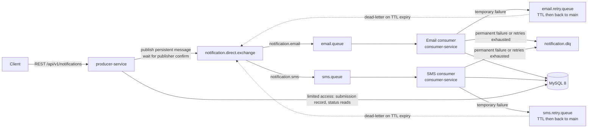
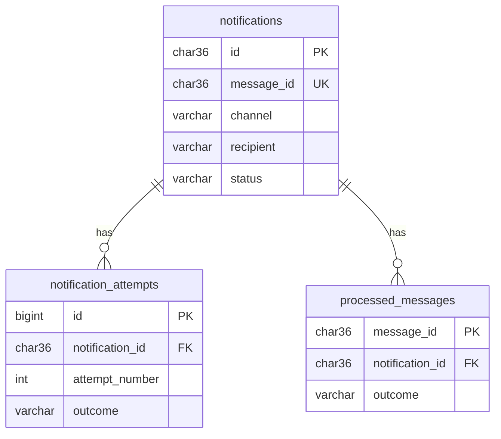

# RabbitMQ Engineering Lab — Project Document

> **Document set:** `project.md` (this file) · `api.md` · `implementation.md` · `flow.md` · `roadmap.md`
> **Last updated:** 2026-11-09
> **Purpose:** Explain what we are building and why. After reading this file, a developer should understand the goals, scope, architecture and requirements of the project.

---

## 0. How to Read This Document Set

Every statement in these documents carries one of four bases. Where it matters, the basis is shown in a **Basis** column or in brackets.

| Label | Meaning |
|---|---|
| **Confirmed** | Stated in the original project requirements. |
| **Proposed** | A design decision we recommend because the requirements left it open. Listed in the Decision Register (section 15) with an ID such as `PD-02`. |
| **Open** | A question that is not yet decided. Listed in section 15 with an ID such as `OQ-01`. |
| **Future** | A possible enhancement that is explicitly *not* part of the initial build. |

**Canonical names** (used identically in all five files):

| Item | Name |
|---|---|
| Repository / parent module | `rabbitmq-engineering-lab` |
| Maven modules | `shared-contracts`, `producer-service`, `consumer-service` |
| Main exchange (direct) | `notification.direct.exchange` |
| Retry exchange (direct) | `notification.retry.exchange` |
| Dead-letter exchange (direct) | `notification.dlx.exchange` |
| Lab exchanges | `notification.topic.exchange`, `notification.fanout.exchange` |
| Main queues | `email.queue`, `sms.queue` |
| Retry queues | `email.retry.queue`, `sms.retry.queue` |
| Dead-letter queue | `notification.dlq` |
| Routing keys | `notification.email`, `notification.sms` (main); `email.retry`, `sms.retry` (retry); `notification.dead` (dead letter) |
| Channels | `EMAIL`, `SMS` |
| Consumer names | `email-consumer`, `sms-consumer` |

---

## 1. Project Introduction

**RabbitMQ Engineering Lab** is a practical backend engineering project. We build an **Asynchronous Notification Processing System** with two independent Spring Boot applications that communicate only through RabbitMQ.

- A client submits a request to send an **EMAIL** or **SMS** notification through a REST API.
- The **Producer Service** validates the request, wraps it in a message and publishes it to RabbitMQ. It does **not** send anything itself.
- The **Consumer Service** receives the message, simulates delivery, records the outcome in MySQL, and handles failures with retries and a dead-letter queue.

The project is a learning vehicle. The notification domain is deliberately simple so that attention stays on RabbitMQ behaviour: routing, acknowledgements, durability, retries, dead-lettering, idempotency and concurrency.

## 2. Problem Statement

A naive notification API sends the email or SMS inside the HTTP request. This causes well-known problems:

1. **Slow responses.** The client waits for a slow external provider.
2. **Tight coupling.** If the provider is down, the API fails too.
3. **Lost work.** If the application crashes mid-request, nobody knows whether the notification was sent.
4. **Poor scalability.** Request handling and delivery cannot be scaled independently.
5. **No controlled recovery.** Failures need ad-hoc handling instead of a defined retry and escalation policy.

Asynchronous messaging addresses these problems, but it introduces new ones that engineers must understand: messages can be delivered more than once, brokers can restart, consumers can crash after doing work but before confirming it, and "accepted by the broker" is not the same as "delivered to the user". This project explores these problems hands-on.

## 3. Project Objectives

**Learning objectives (Confirmed)**

1. Understand direct, topic and fanout exchanges through practical scenarios.
2. Understand queues, bindings, routing keys, acknowledgements and redelivery.
3. Understand message durability: persistent messages and durable queues.
4. Implement retries and dead-letter handling with TTL and Dead Letter Exchanges.
5. Implement publisher confirms and understand their limits.
6. Build idempotent consumers and explain why exactly-once *business* processing is not guaranteed by RabbitMQ.
7. Tune consumer concurrency and prefetch and observe the effects.
8. Observe and test failure scenarios deliberately.

**Engineering objectives (Confirmed)**

1. A Maven multi-module repository with clear module boundaries.
2. Test-driven, incremental implementation (JUnit 5, Testcontainers).
3. Documentation (Markdown + Mermaid) that stays consistent with the implementation.

## 4. Business Use Case

A fictional company sends transactional notifications such as "Your order #1042 has shipped" (EMAIL) or "Your verification code is 482913" (SMS). Other internal systems call our REST API. Requirements from the business side:

- The API must respond quickly and must never claim a notification was *delivered* when it has only been *queued*.
- A temporary provider outage must not lose notifications.
- A notification that can never be delivered must be isolated for inspection instead of retried forever.
- Operators must be able to ask: "What happened to notification X?"

Delivery is **simulated** in this project; no real provider is called.

## 5. System Overview



The Producer and Consumer never call each other. The only shared infrastructure is RabbitMQ and one MySQL schema (see `PD-01`).

## 6. Technology Stack

**Confirmed**

| Technology | Purpose |
|---|---|
| Java 21 | Programming language |
| Spring Boot 3 | Backend framework |
| Spring AMQP | RabbitMQ integration |
| RabbitMQ 4 (`rabbitmq:4-management` image) | Message broker |
| MySQL 8 | Persistent storage |
| Spring Data JPA / Hibernate | Database interaction |
| Maven | Build management, multi-module |
| Docker Compose | Local infrastructure |
| JUnit 5 | Unit testing |
| Testcontainers | Integration testing |
| OpenAPI / Swagger | API documentation |
| Markdown, Mermaid | Documentation and diagrams |

**Proposed supporting additions** (`PD-11`) — small libraries needed to make the confirmed stack work properly:

| Addition | Reason |
|---|---|
| Spring Boot Starter Validation (Bean Validation) | Request validation |
| springdoc-openapi | Generates the OpenAPI document and Swagger UI for Spring Boot |
| Flyway | Versioned MySQL schema migrations |
| Spring Boot Actuator + Micrometer | Health checks and metrics |
| Spring Boot Starter Test | Brings Mockito, AssertJ and Awaitility, used for async test assertions |

## 7. Architecture Overview and Component Responsibilities

### 7.1 Producer Service (`producer-service`)

| Responsibility | Basis |
|---|---|
| Expose the REST APIs (`POST`, `GET by id`, `GET list`). | Confirmed |
| Validate notification requests. | Confirmed |
| Generate `notificationId`, `messageId` and `correlationId`. | Confirmed |
| Build the message contract and select the routing key from the channel. | Confirmed |
| Publish persistent messages to RabbitMQ and handle publisher confirms and returns. | Confirmed |
| Return publishing status; never claim delivery. | Confirmed |
| Create the initial `notifications` row (`PENDING_PUBLISH`) and mark it `QUEUED` or `PUBLISH_FAILED`. | Proposed (`PD-01`) |
| **Must not** process or "deliver" notifications. | Confirmed |

### 7.2 Consumer Service (`consumer-service`)

| Responsibility | Basis |
|---|---|
| Consume independently from `email.queue` and `sms.queue`. | Confirmed |
| Simulate EMAIL and SMS delivery. | Confirmed |
| Store processing status and every processing attempt. | Confirmed |
| Acknowledge or reject messages manually. | Confirmed |
| Classify failures as temporary or permanent; retry temporary ones; dead-letter the rest. | Confirmed |
| Prevent duplicate business processing (idempotent consumer). | Confirmed |
| Process messages concurrently with configurable prefetch. | Confirmed |
| Own the MySQL schema and its migrations. | Confirmed |
| Declare the RabbitMQ topology (exchanges, queues, bindings). | Proposed (`PD-06`) |

### 7.3 RabbitMQ

Receives messages, routes them through exchanges to queues, stores them durably, delivers them to consumers, supports acknowledgements and redelivery, and supports TTL and dead-lettering. The **Management UI** (port 15672) is the monitoring tool.

### 7.4 `shared-contracts`

A plain Java library holding the message DTO, the channel enum and the naming constants (exchange, queue and routing-key names). It contains **no** business logic and **no** Spring configuration.

## 8. Messaging Design Overview

### 8.1 Exchanges

| Exchange | Type | Role | Basis |
|---|---|---|---|
| `notification.direct.exchange` | direct | Main path. Exact routing-key match (`notification.email`, `notification.sms`). Also the return target for retried messages. | Confirmed |
| `notification.retry.exchange` | direct | Receives messages scheduled for retry. | Proposed (`PD-02`) |
| `notification.dlx.exchange` | direct | Receives rejected and exhausted messages. | Confirmed concept; naming proposed |
| `notification.topic.exchange` | topic | **Lab scenario only.** Pattern routing such as `notification.*`. | Confirmed concept; lab-only is `PD-07` |
| `notification.fanout.exchange` | fanout | **Lab scenario only.** Broadcast to all bound queues. | Confirmed concept; lab-only is `PD-07` |

### 8.2 Queues

| Queue | Bound to | Binding key | Purpose |
|---|---|---|---|
| `email.queue` | `notification.direct.exchange` | `notification.email` | Pending EMAIL messages. Dead-letters to `notification.dlx.exchange`. |
| `sms.queue` | `notification.direct.exchange` | `notification.sms` | Pending SMS messages. Dead-letters to `notification.dlx.exchange`. |
| `email.retry.queue` | `notification.retry.exchange` | `email.retry` | Holds an EMAIL message for a fixed delay (queue TTL), then dead-letters it back to `notification.direct.exchange` with key `notification.email`. No consumer. |
| `sms.retry.queue` | `notification.retry.exchange` | `sms.retry` | Same for SMS, returning with key `notification.sms`. No consumer. |
| `notification.dlq` | `notification.dlx.exchange` | `notification.dead` | Final parking place for messages that cannot be processed. Inspected manually. |

**Retry topology recommendation (`PD-02`).** The original queue list contains one `notification.retry.queue`. We recommend **one retry queue per channel** instead. Trade-offs:

| Option | Advantages | Disadvantages |
|---|---|---|
| One shared retry queue with *per-message* TTL | Single queue | RabbitMQ only expires messages at the head of a queue, so a long-TTL message blocks shorter ones behind it (head-of-line blocking). Delay cannot be varied reliably. |
| One shared retry queue with *queue-level* fixed TTL | Simple; works for one delay | Needs special routing-key handling to return to the right channel; no per-channel visibility or delay. |
| **One retry queue per channel, fixed queue-level TTL (recommended)** | No head-of-line blocking; the return route is explicit; backlog per channel is visible in the UI; channels can use different delays | More queues to declare |
| Tiered queues per channel (e.g. short, medium, long delay) | True backoff | Even more queues; more code. **Future** (`OQ-08`). |
| In-process blocking retry (sleep inside the consumer) | No extra queues | Holds a consumer thread and an unacknowledged message; lost on crash. Not recommended. |

The roadmap includes an experiment that demonstrates head-of-line blocking so the reasoning is learned, not just stated.

### 8.3 Message Contract (Confirmed)

JSON, UTF-8, `content_type = application/json`, delivery mode persistent.

| Field | Type | Description |
|---|---|---|
| `messageId` | UUID string | Identifies the *message*. Stays the same across redelivery and retries. This is the idempotency key. |
| `notificationId` | UUID string | Identifies the *notification*. Returned to the client. |
| `channel` | string | `EMAIL` or `SMS`. |
| `recipient` | string | Email address or E.164 phone number. |
| `message` | string | Notification text. |
| `createdAt` | ISO-8601 UTC timestamp | When the Producer created the message. |
| `correlationId` | string | Traces one request across Producer, broker and Consumer. |
| `retryCount` | integer | `0` on first publish; incremented by the Consumer each time it schedules a retry. |

```json
{
  "messageId": "0b8f4e2a-5d3c-4c1e-9a7f-2f6d1c8e4b90",
  "notificationId": "7c9e6679-7425-40de-944b-e07fc1f90ae7",
  "channel": "EMAIL",
  "recipient": "alice@example.com",
  "message": "Your order #1042 has shipped.",
  "createdAt": "2026-11-09T10:15:30.123Z",
  "correlationId": "req-20261109-0001",
  "retryCount": 0
}
```

### 8.4 Delivery guarantees in one paragraph

With publisher confirms, persistent messages, durable queues and manual acknowledgements, the system provides **at-least-once** delivery to the Consumer. Duplicates are therefore possible, and the Consumer is made **idempotent** so that a duplicate does not produce a second recorded outcome. RabbitMQ does **not** guarantee exactly-once business processing, and this project does not claim it. The full explanation is in `implementation.md` section 12.

## 9. Database Overview

MySQL 8 holds one schema, `notification_lab`. The Consumer owns the schema and its Flyway migrations.

| Table | Responsibility |
|---|---|
| `notifications` | One row per notification: details plus current status. |
| `notification_attempts` | One row per completed processing attempt and its outcome. |
| `processed_messages` | One row per message that reached a final outcome; used for idempotency. |



### 9.1 Notification status model (Proposed, `PD-09`)

| Status | Meaning | Set by |
|---|---|---|
| `PENDING_PUBLISH` | Request accepted and stored; broker has not yet confirmed the message. | Producer |
| `QUEUED` | RabbitMQ confirmed it accepted the message. **Not delivered.** | Producer |
| `PUBLISH_FAILED` | The Producer could not get a broker confirmation (nack, timeout, unroutable or broker unavailable). | Producer |
| `PROCESSING` | A consumer is working on an attempt. | Consumer |
| `RETRY_SCHEDULED` | A temporary failure occurred; the message waits in a retry queue. | Consumer |
| `SENT` | The simulated delivery succeeded. Final. | Consumer |
| `DEAD_LETTERED` | Permanent failure or retries exhausted; the message went to `notification.dlq`. Final. | Consumer |

Allowed transitions and their diagram are in `flow.md` section 16. Table columns, keys and indexes are in `implementation.md` section 8.

## 10. Functional Requirements

Requirements are grouped by component. "Component" is the group heading. **Basis** is *Confirmed* unless stated.

### 10.1 Producer Service

| ID | Requirement (what) | Why | Expected behaviour | Basis |
|---|---|---|---|---|
| FR-P-01 | **Notification submission.** Accept `POST /api/v1/notifications` with channel, recipient and message. | Entry point of the system. | Returns `202 Accepted` with `notificationId`, `messageId`, status `QUEUED`. Never returns "delivered". | Confirmed |
| FR-P-02 | **Notification validation.** Validate channel, recipient format for the channel, and message length before any publishing. | Reject bad input early; protect consumers from poison messages. | Invalid input gives `400` with the standard error body and per-field details. Nothing is published. | Confirmed |
| FR-P-03 | **ID generation.** Generate `notificationId`, `messageId`; accept or generate `correlationId`. | Enables tracking and idempotency. | IDs are UUIDs; `correlationId` is echoed in response header and logs. | Confirmed |
| FR-P-04 | **Message creation.** Build the JSON message per the contract with `retryCount = 0`. | A stable contract decouples the services. | Message fields match section 8.3 exactly. | Confirmed |
| FR-P-05 | **Routing key selection.** `EMAIL` → `notification.email`, `SMS` → `notification.sms`. | Directs the message to the right consumer. | Unknown channel never reaches the broker. | Confirmed |
| FR-P-06 | **Persistent publishing.** Publish as persistent to `notification.direct.exchange`. | Messages survive a broker restart (together with durable queues). | `delivery_mode = 2` visible in the Management UI. | Confirmed |
| FR-P-07 | **Publisher confirms and returns.** Wait for a broker confirm (timeout) and detect unroutable messages (mandatory flag). | Only a confirm tells the Producer the broker took responsibility. | Ack → `QUEUED`. Nack, timeout or return → `PUBLISH_FAILED`. | Confirmed |
| FR-P-08 | **Publishing failure handling.** Report publish failures clearly. | Clients must know the notification was not accepted. | `503 MESSAGE_PUBLISH_FAILED`; error body includes `notificationId` when a record exists. | Confirmed |
| FR-P-09 | **Submission record.** Create a `notifications` row before publishing and update its status after the confirm outcome. | Lets `GET` answer correctly before the Consumer has seen the message. | Row exists with `PENDING_PUBLISH` before publish. Conditional updates never overwrite a later Consumer status. | **Proposed** (`PD-01`) |
| FR-P-10 | **Status retrieval.** `GET /api/v1/notifications/{id}`. | Clients and operators need the current state. | Returns status, counters, last error and attempt history; `404` if unknown. | Confirmed |
| FR-P-11 | **Listing and filtering.** `GET /api/v1/notifications` with filters and pagination. | Operational overview. | Filter by status, channel, date range; paginated and sorted. | Confirmed |

### 10.2 Consumer Service

| ID | Requirement (what) | Why | Expected behaviour | Basis |
|---|---|---|---|---|
| FR-C-01 | **Independent EMAIL consumer** on `email.queue`. | Channels must scale and fail independently. | Own listener container, concurrency and prefetch settings. | Confirmed |
| FR-C-02 | **Independent SMS consumer** on `sms.queue`. | Same. | Same, separately configurable. | Confirmed |
| FR-C-03 | **Simulated delivery.** Per-channel simulator with deterministic outcomes. | Lets us test success, temporary failure, permanent failure and slow processing without real providers. | Rules defined in `implementation.md` section 10 (`PD-12`). | Confirmed (simulation); rules Proposed |
| FR-C-04 | **Processing status persistence.** Update `notifications.status` as processing progresses. | Visible, queryable state. | Status follows the model in 9.1. | Confirmed |
| FR-C-05 | **Attempt tracking.** Record every finished attempt in `notification_attempts`. | Auditability and retry accounting. | One row per attempt with outcome, error and timing. | Confirmed |
| FR-C-06 | **Manual ACK/NACK.** Acknowledge only after the outcome is durably recorded. | Prevents message loss on crash. | Success: ack. Permanent or exhausted: nack without requeue (to DLQ). Retry: publish to retry exchange, then ack. | Confirmed |
| FR-C-07 | **Failure classification.** Separate temporary from permanent failures. | Retrying a permanent failure wastes resources. | Temporary → retry path. Permanent → DLQ immediately. | Confirmed |
| FR-C-08 | **Retry mechanism.** Delay and re-attempt temporary failures up to a configured limit. | Recovers from transient problems. | Retry via per-channel retry queue (TTL, then dead-letter back). Default 3 retries, 10 s delay (`PD-10`). | Confirmed; topology Proposed |
| FR-C-09 | **DLQ handling.** Route exhausted and permanent failures to `notification.dlq`. | Isolate unprocessable messages. | Status `DEAD_LETTERED`; message visible in `notification.dlq`. | Confirmed |
| FR-C-10 | **Duplicate protection (idempotency).** Do not process a message that already reached a final outcome. | At-least-once delivery means duplicates happen. | Duplicate is acknowledged (or re-rejected if it was dead-lettered) without a second outcome record. | Confirmed |
| FR-C-11 | **Concurrency and prefetch.** Configurable consumer threads and prefetch per queue. | Throughput and fairness control. | Several messages processed in parallel; no message processed twice by design. | Confirmed |
| FR-C-12 | **Malformed message handling.** Reject unparseable messages without requeue. | Avoid infinite redelivery loops. | Message goes to `notification.dlq`; logged with AMQP `message_id` if present. | Proposed |

### 10.3 RabbitMQ Topology

| ID | Requirement | Why | Expected behaviour | Basis |
|---|---|---|---|---|
| FR-B-01 | **Direct routing** on `notification.direct.exchange`. | Core routing mechanism. | Exact key match to `email.queue` / `sms.queue`. | Confirmed |
| FR-B-02 | **Topic exchange scenario.** | Learn pattern routing. | `notification.*` and `.#` patterns demonstrated with lab queues. | Confirmed (lab-only `PD-07`) |
| FR-B-03 | **Fanout exchange scenario.** | Learn broadcast. | One message reaches every bound lab queue. | Confirmed (lab-only `PD-07`) |
| FR-B-04 | **Durable topology with dead-letter arguments.** | Survive restarts; reject → DLQ. | Durable exchanges and queues; main queues dead-letter to `notification.dlx.exchange`. | Confirmed |
| FR-B-05 | **Retry topology** (TTL + dead-letter back). | Delayed retries without blocking consumers. | Per-channel retry queues as in section 8.2. | Proposed (`PD-02`) |
| FR-B-06 | **Monitoring through Management UI.** | Observe queues, rates, connections. | Operators can see ready, unacked and DLQ counts. | Confirmed |

## 11. Non-Functional Requirements

Non-functional requirements describe *qualities* of the system, not features. Items below are **design goals**. We do not invent numerical service-level targets; any number we later report must come from our own measurements (see NFR-03) and be labelled *measured*.

| ID | Requirement and meaning | Why needed | How we address it | How we verify |
|---|---|---|---|---|
| NFR-01 | **Reliability** — an accepted notification is not silently lost. | The core value of using a broker. | Publisher confirms, persistent messages, durable queues, manual acks, retries, DLQ. | Failure experiments (Phase 10): kill consumer, restart broker, stop broker; count messages end-to-end. |
| NFR-02 | **Message durability** — messages survive a broker restart. | Restarts happen. | Durable exchanges and queues; `delivery_mode = 2`; durable Docker volume for RabbitMQ data. | Publish, restart container, confirm queue depth unchanged. |
| NFR-03 | **Performance** — API stays responsive; consumers keep up under moderate load. *Design goal only.* | Async design exists to decouple latency. | API does no delivery work; tuned prefetch and concurrency. | Load experiments in Phase 8; record observed throughput and latency as *measured results* on the developer machine. |
| NFR-04 | **Scalability** — consumers can be scaled by running more threads or more instances. | Handle more load without code changes. | Competing consumers on one queue; stateless consumers; DB constraints guard correctness. | Run two consumer instances; verify each message processed once and load is shared. |
| NFR-05 | **Availability assumptions** — single local RabbitMQ and MySQL; no clustering. | Keep scope focused. | Auto-reconnect in Spring AMQP; documented behaviour during outages. High availability is out of scope. | Stop and start infrastructure; applications recover without manual restart. |
| NFR-06 | **Fault tolerance** — tolerate crashes, temporary failures and broker/DB outages. | Failures are the learning topic. | Redelivery, retry queues, DLQ, classification of failures, bounded retries. | Scenario tests in `roadmap.md` Phase 10 (9 scenarios). |
| NFR-07 | **Data consistency** — status data reflects reality; clear rules where it cannot be atomic. | Broker and DB cannot share a transaction. | Defined transaction boundaries; conditional status updates; outcome recorded before ack. Known gap: Producer DB-write/publish is not atomic (`OQ-02`). | Integration tests on status transitions; query for rows stuck in `PENDING_PUBLISH`. |
| NFR-08 | **Idempotency** — processing the same message twice yields one recorded outcome. | Duplicates are inevitable with at-least-once. | `processed_messages` plus unique constraints. | Publish same message twice; crash between commit and ack; concurrent duplicates test. |
| NFR-09 | **Maintainability** — modular, readable, documented. | Long-lived learning reference. | Module boundaries, shared constants, layered packages, docs updated per task. | Code review checklist; cross-document consistency review (task T-10.5). |
| NFR-10 | **Observability** — we can follow one notification end to end. | Debugging asynchronous systems is hard. | `correlationId` in logs (MDC), Actuator health and metrics, Management UI, attempt history in DB. | Trace one request through both applications' logs using only the `correlationId`. |
| NFR-11 | **Security** — protect secrets and data within local scope; no authentication (out of scope). | Good habits even in a lab. | Dedicated broker and DB users, least-privilege DB grants, secrets via environment variables, no PII in logs, Swagger only in local profile. | Configuration review; grep logs for recipients and message bodies. |
| NFR-12 | **Testability** — behaviour can be tested automatically. | Test-driven roadmap. | Pure-logic units; Testcontainers for broker and DB; Awaitility for async assertions; deterministic simulator. | Test suite runs with one Maven command and needs only Docker. |

## 12. Scope and Limitations

**In scope:** everything in sections 1–11.

**Out of scope (Confirmed):** frontend; real email or SMS providers; user authentication; Kubernetes; complex templates; multi-tenancy; unrelated business features.

**Known limitations (accepted):**

1. Delivery is simulated; `SENT` means "the simulation succeeded".
2. Single-node RabbitMQ and MySQL; no high availability.
3. The Producer's DB write and its publish are not atomic (`OQ-02`).
4. A publisher-confirm timeout is ambiguous: the broker may have accepted the message even though the client received `503`. A client that resubmits may cause a duplicate notification (`OQ-05`).
5. Idempotency prevents duplicate recorded outcomes. It cannot prevent two in-flight attempts from both calling a real provider unless a processing lease is added (`OQ-04`).
6. Messages in `notification.dlq` are inspected and replayed manually; there is no replay tool (`OQ-01`).
7. No message ordering guarantee across concurrent consumers.

## 13. Assumptions

| ID | Assumption |
|---|---|
| A-01 | Developers have Java 21, Maven 3.9+ and Docker with Compose installed. |
| A-02 | Everything runs on one developer machine; Producer and Consumer run on the host, only RabbitMQ and MySQL run in Docker (`PD-15`). |
| A-03 | Ports: Producer 8080, Consumer 8081 (Actuator only), RabbitMQ 5672 and 15672, MySQL 3306. |
| A-04 | Time is stored and exchanged in UTC. |
| A-05 | Notification ordering does not matter. |
| A-06 | Message bodies are small (under 1,000 characters). |
| A-07 | The Producer and Consumer are deployed with compatible versions of `shared-contracts`. |

## 14. Expected Final Outcome

At the end of the roadmap we will have:

1. A working Maven multi-module system that accepts notification requests, routes them through RabbitMQ and processes them independently.
2. Observable behaviour for every reliability scenario in `implementation.md` section 12, backed by automated tests and recorded experiments.
3. A developer who can explain, from experience: exchange types, acknowledgements, redelivery, publisher confirms, TTL, DLX, DLQ, prefetch, idempotency and why exactly-once processing is not a broker feature.
4. Five consistent documents that match the running system.

## 15. Decision Register

**Proposed decisions** (adopted unless changed; each is justified in `implementation.md`)

| ID | Decision |
|---|---|
| PD-01 | The Producer writes the initial `notifications` row (`PENDING_PUBLISH`, then `QUEUED` / `PUBLISH_FAILED`) and reads status data, using a restricted DB user. The Consumer owns the schema and all processing writes. *Alternatives:* Producer without storage (status unknown until consumed, `GET` returns `404` for fresh notifications); Producer calls a Consumer API (synchronous coupling). |
| PD-02 | Per-channel retry queues (`email.retry.queue`, `sms.retry.queue`) replace the single `notification.retry.queue`. |
| PD-03 | Retry is performed by the Consumer republishing the message to `notification.retry.exchange` with `retryCount + 1` and the same `messageId`, then acknowledging the original. |
| PD-04 | One shared `notification.dlq` for both channels. |
| PD-05 | Start with classic durable queues; compare with quorum queues in an optional Phase 10 experiment. |
| PD-06 | The Consumer declares the full topology. The Producer declares only `notification.direct.exchange`. Unroutable publishes are caught by the mandatory flag. |
| PD-07 | Topic and fanout exchanges are lab-only scenarios using lab queues, the Management UI and tests; no REST endpoint is added for them. |
| PD-08 | The Producer waits synchronously for the publisher confirm (default timeout 5 s) before answering the HTTP request. |
| PD-09 | Status model as in section 9.1. |
| PD-10 | Defaults: max retries 3 (up to 4 attempts), retry delay 10 s, prefetch 10, consumer concurrency 2 (max 4) per queue, page size 20 (max 100). All configurable and to be tuned by experiment. |
| PD-11 | Add Bean Validation, springdoc-openapi, Flyway, Actuator/Micrometer. |
| PD-12 | Simulated delivery outcomes are controlled by reserved recipients (documented in `implementation.md`). |
| PD-13 | Idempotency record is written in the same DB transaction as the final outcome; no processing lease initially. |
| PD-14 | Validation limits: message 1–1000 characters; EMAIL recipient valid address up to 254 characters; SMS recipient E.164. |
| PD-15 | Applications run on the host; only infrastructure runs in Docker Compose. |

**Open questions**

| ID | Question |
|---|---|
| OQ-01 | How should DLQ messages be replayed, given that a replayed message has the same `messageId` and would be treated as a duplicate? (Likely: a deliberate replay procedure that clears the idempotency record or assigns a new `messageId`.) |
| OQ-02 | Do we add a transactional outbox or a sweeper to close the Producer DB-write/publish gap? (Future.) |
| OQ-03 | How does the Producer's integration test obtain the Consumer-owned schema? (Proposed: reuse the Flyway scripts via test resources.) |
| OQ-04 | Do we add a processing lease to stop concurrent in-flight duplicates? |
| OQ-05 | Do we add an `Idempotency-Key` request header to protect against client resubmission? (Future.) |
| OQ-06 | What retention policy applies to `processed_messages` and old notifications? |
| OQ-07 | Use `CHAR(36)` UUIDs (readable) or `BINARY(16)` (smaller, faster) for IDs? Proposed: `CHAR(36)` for readability. |
| OQ-08 | Add tiered retry queues for exponential backoff? (Future.) |
